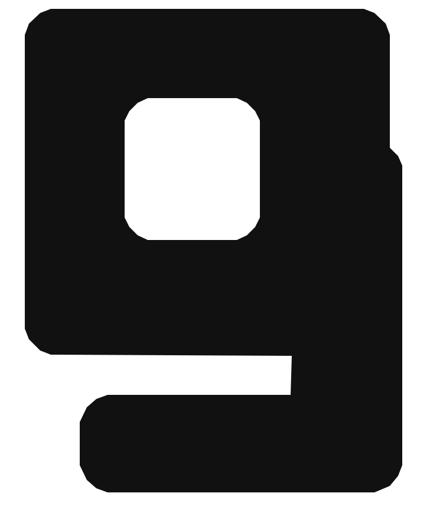

# KnockIT Display — glifo `g` homologado

**Decisão:** a alternativa **A** do estudo v0.16 foi aprovada em 12/11/2026. Alternativas B e C descartadas.

- **Origem:** KnockIT Display v0.15, criação tipográfica original da marca. Não é derivação de SuperMario85 ou Game Stage.
- **Mudança aprovada:** refino sutil do peso visual do `g`; ligeira ampliação da contraforma e redução de 14 unidades na massa do terminal inferior.
- **Integridade:** geometria original guardada no SVG vetorial. O SHA-256 e os checksums das compilações TTF e WOFF2 estão em [`manifest.json`](manifest.json).
- **Regra de preservação:** nenhuma alteração em `g` sem nova aprovação; os demais caracteres aprovados não devem ser redesenhados ao integrá-lo.
- **Distribuição:** arquivos compilados disponíveis no repositório público conforme autorização expressa. Licença para reutilização por terceiros ainda não definida; não atribuir licença aberta automaticamente.

**Downloads da opção A homologada:** [TTF instalável](KnockIT_Display_v0.16_g_A.ttf) · [WOFF2 para web](KnockIT_Display_v0.16_g_A.woff2).

A fonte compilada é experimental como família completa. As variantes B e C permanecem reprovadas; logotipo e símbolos oficiais não foram alterados.
