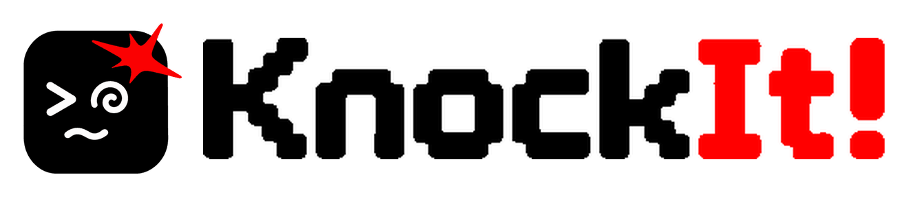
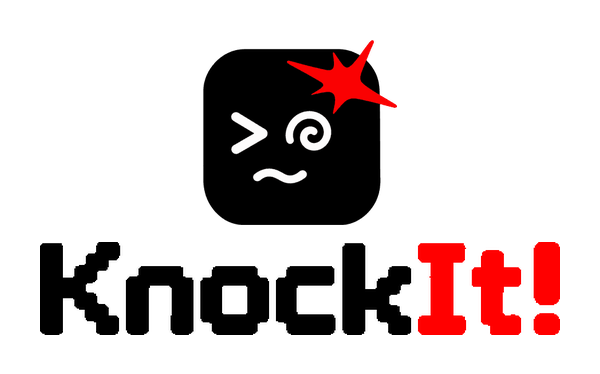
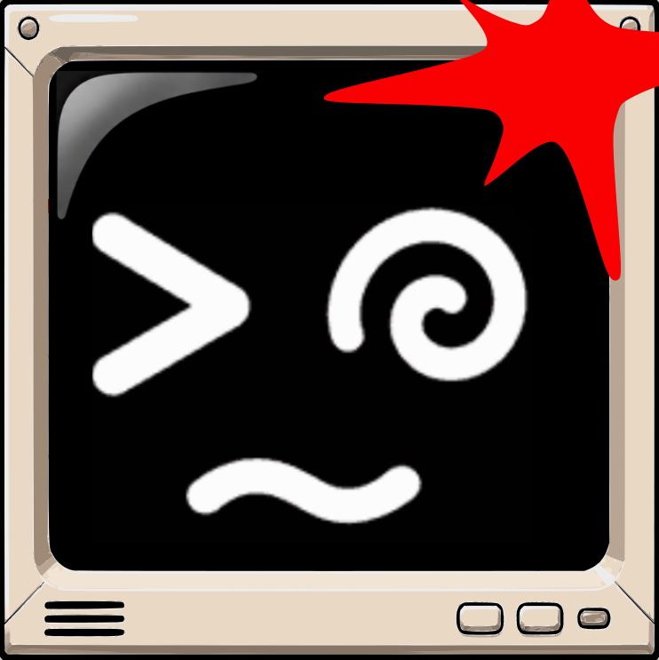

# KnockIt! · Assinaturas mistas homologadas

**Status:** homologadas pelo usuário em 11/11/2026.  
**Fonte:** símbolo gráfico oficial e logotipo tipográfico oficial, sem redesenho.  
**Regra:** alterar apenas escala proporcional e disposição; nenhuma alteração em forma, lettering ou paleta.

## 01 · Horizontal principal

Aprovação: texto ampliado em relação ao primeiro estudo, mantendo-se integralmente entre as margens superior e inferior do símbolo. Símbolo à esquerda, logotipo à direita.

## 03 · Vertical institucional

Aprovação: símbolo acima, logotipo centralizado abaixo.

## Observações técnicas
- Arquivos PNG RGBA com fundo transparente.
- Esta documentação registra **composições** já aprovadas; não substitui os arquivos-fonte originais homologados.
- Negativo cromático não deve ser confundido com adaptação automática a tema escuro.

## 04 · Símbolo CRT — v2 oficial

**Status:** OFICIAL / HOMOLOGADO pelo usuário em **11/11/2026**.  
**Tipo:** segunda versão oficial do símbolo gráfico KnockIt!, variante *monitor CRT*.  
**Arquivo-fonte:** [PNG oficial v2](../assets/KnockIT_simbolo_CRT_v2_oficial.png).

### Intenção e regras de integridade
- Carcaça de **monitor retrô compacto** com proporção quase quadrada; tela preta dominante e moldura bege com faixa inferior fina, grelhas e botões.
- Símbolo facial branco original: olho `>`, olho em espiral e boca ondulada `~`.
- O **smack vermelho** é uma pancada no **hardware**; ele atravessa a borda superior e direita da carcaça deliberadamente. **Não** confiná-lo à tela nem interpretá-lo como efeito saindo do software.
- Esta variante CRT foi aprovada na composição final enviada pelo usuário. A versão aqui arquivada contém **apenas limpeza de artefatos de pixels**, sem redesenho da geometria, do rosto ou do smack.
- **Não substituir** `assets/symbol.png`, `assets/logo.png` ou outras versões homologadas. A variante v2 coexiste com as anteriores.

### Dados técnicos da versão congelada
- PNG, RGBA; **742 × 743 pixels**.
- SHA-256: `33934db35bb213e3fb56c867da23effd29a7976585bdd3d7c1265eb4df505e5e`
- Git blob SHA: `00f2408e54aba1163bb1a99491df7e36e3b98165`
- Nome oficial: `KnockIT_simbolo_CRT_v2_oficial.png`
