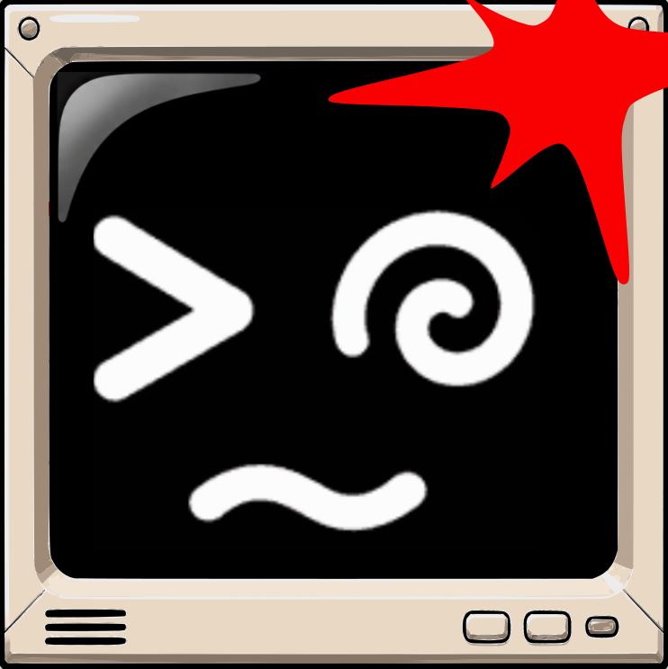
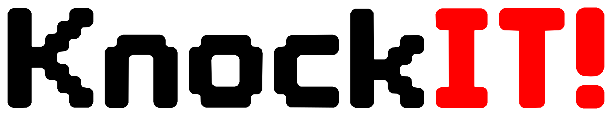
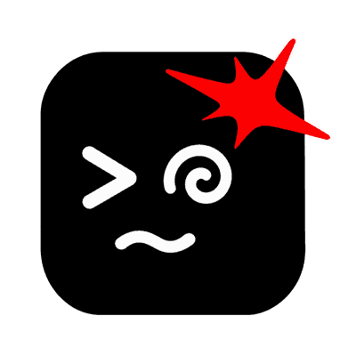

  

    
  

  

    
  

  <h3>Small Changes. Big Impact.</h3>

  
<strong>Software · Automation · Technology with personality</strong>

  
Simple ideas. Thoughtful solutions. Real impact.

  
Part of the <a href="https://github.com/archersland">Archersland</a> ecosystem.

---

### 👋 Hello, we're KnockIt!

We create useful software and digital tools that solve real problems, without making things more complicated than they need to be.

### Our approach

| 🎯 Keep it simple | 🛠️ Build with care | ⚡ Make a difference |
| :--- | :--- | :--- |
| Make things easy to understand. | Create reliable tools that can grow. | Focus on what actually helps people. |

---

<strong>Brand assets · official artwork</strong>

 

Our official symbols and wordmark are kept as approved. Different versions can be used for different purposes without replacing the original artwork.

| Original symbol | Official wordmark |
| :---: | :---: |
|  |  |

### Wordmark from KnockIT Display

The logo above is exported from our own KnockIT Display font, with transparent background and without redrawing any glyphs. [Original vector](../assets/wordmarks/KnockIT_Display_original_transparente.svg) · [Black and white](../assets/wordmarks/KnockIT_Display_preto_e_branco.svg) · [Exact RGB negative](../assets/wordmarks/KnockIT_Display_negativo_cromatico_RGB.svg).

### CRT symbol v2 · official

Approved on November 11, 2026. The red impact mark hits the computer's case; the face stays on the screen. [See the official artwork and brand guidelines](../docs/IDENTIDADE-VISUAL.md#04--símbolo-crt--v2-oficial).

